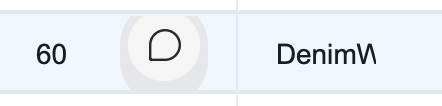

<div align="center">


<br />
<br />

# Google Sheets-Style Grid with Velt Comments

### A spreadsheet-style AG Grid with cell comments and notifications

A Next.js AG Grid spreadsheet where Velt popover comments are attached to cells, with a custom mention autocomplete and a notification bell in the header.

<br />

[![Built by Studio1](https://img.shields.io/badge/Built_by_Studio1-f97316?style=for-the-badge&logo=data%3Aimage%2Fsvg%2Bxml%3Bbase64%2CPHN2ZyB4bWxucz0iaHR0cDovL3d3dy53My5vcmcvMjAwMC9zdmciIHZpZXdCb3g9IjAgMCAxNjAgMTYwIiBmaWxsPSJub25lIj48cGF0aCBmaWxsLXJ1bGU9ImV2ZW5vZGQiIGNsaXAtcnVsZT0iZXZlbm9kZCIgZD0iTTAgMzVDMCAxNi42ODA3IDE0LjA3NDQgMS42NDg0NCAzMiAwLjEyNjk1M1YxNDFINTEuMDUyM0M1Mi40MzA4IDEzNy4zNDQgNTQuNzQ0NiAxMzMuNjg5IDU3Ljk5MzggMTMwLjAzM0M2MS4xNDQ2IDEyNi41MDggNjQuNjg5MiAxMjMuNDQgNjguNjI3NyAxMjAuODI5QzcyLjU2NjIgMTE4LjM0OSA3Ni4zNTY5IDExNi43ODIgODAgMTE2LjEyOVY4Ni43NTQ0Qzc1LjQ3MDggODcuOTI5MiA3MS4zODQ2IDg5LjY5MTkgNjcuNzQxNSA5Mi4wNDE1QzY0IDk0LjUyMjUgNjAuNzUwOCA5Ny40NiA1Ny45OTM4IDEwMC44NTRDNTYuNTM0NSAxMDIuNzIgNTUuMjU0NSAxMDQuNjU5IDU0LjE1MzkgMTA2LjY3MVYwSDEyNUMxNDQuMzMgMCAxNjAgMTUuNjY5OSAxNjAgMzVWMTI1QzE2MCAxNDQuMzMgMTQ0LjMzIDE2MCAxMjUgMTYwSDEyNFYxOEgxMDQuOTQ4QzEwMy41NjkgMjEuNjgxNiAxMDEuMjU1IDI1LjM2MjggOTguMDA2MiAyOS4wNDQ0Qzk0Ljg1NTQgMzIuNTk0MiA5MS4zMTA4IDM1LjY4NDEgODcuMzcyMyAzOC4zMTRDODMuNDMzOCA0MC44MTIgNzkuNjQzMSA0Mi4zODk2IDc2IDQzLjA0NzRWNzIuNjMwNEM4MC41MjkyIDcxLjQ0NzMgODQuNjE1NCA2OS42NzI0IDg4LjI1ODUgNjcuMzA1N0M5MiA2NC44MDc2IDk1LjI0OTIgNjEuODQ5MSA5OC4wMDYyIDU4LjQzMDdDOTkuNDY1NSA1Ni41NTEzIDEwMC43NDUgNTQuNTk4NiAxMDEuODQ2IDUyLjU3MjNWMTYwSDM1QzE1LjY3IDE2MCAwIDE0NC4zMyAwIDEyNVYzNVoiIGZpbGw9IiNmZmZmZmYiLz48L3N2Zz4K)](https://studio1hq.com)
[](https://velt.dev)
[](https://google-sheet-comment.vercel.app)

[Velt docs](https://docs.velt.dev) &nbsp;·&nbsp; [Velt](https://velt.dev) &nbsp;·&nbsp; [More examples](https://github.com/Studio1HQ) &nbsp;·&nbsp; [studio1hq.com](https://studio1hq.com)

</div>

<br />

## Overview

A spreadsheet in the style of Google Sheets, built with Next.js and AG Grid, with [Velt](https://velt.dev) comments on cells. Users click a cell, add a comment in a popover, and mention teammates with a custom autocomplete. A notification bell in the header surfaces comment activity. A live demo is at [google-sheet-comment.vercel.app](https://google-sheet-comment.vercel.app).

<p align="center"></p>

## Features

- **Cell comments**: `VeltCommentTool` and `VeltComments` in popover mode attach comments to cells.
- **Custom mention autocomplete**: `VeltComments` runs with `customAutocompleteSearch` so you control the mention list.
- **Notifications**: `VeltNotificationsTool` in the header.
- **Spreadsheet grid**: AG Grid for the table, with TanStack Table and Virtual also installed.
- **Multi-user switching**: A user switcher in the header, backed by a Zustand store and predefined users.

## Tech stack

| Layer | Tool |
| --- | --- |
| Framework | [Next.js](https://nextjs.org/) (App Router, Turbopack dev), [TypeScript](https://www.typescriptlang.org/) |
| Collaboration | [Velt](https://velt.dev/) (`@veltdev/react`) |
| Data grid | [AG Grid](https://www.ag-grid.com/) |
| UI | [Tailwind CSS](https://tailwindcss.com/), [Radix UI](https://www.radix-ui.com/), [Lucide](https://lucide.dev/) |
| State | [Zustand](https://zustand-demo.pmnd.rs/) |
| Deployment | [Vercel](https://vercel.com/) |

## Getting started

### Prerequisites

- Node.js 18 or newer
- npm, yarn, pnpm or bun
- A Velt API key from the [Velt console](https://console.velt.dev)

### Installation

```bash
git clone https://github.com/Studio1HQ/google-sheet-comment.git
cd google-sheet-comment
npm install
```

### Environment variables

Create a `.env.local` file in the project root.

| Variable | Description |
| --- | --- |
| `NEXT_PUBLIC_VELT_ID` | Your Velt API key, from the [Velt console](https://console.velt.dev). |

### Run

```bash
npm run dev
```

Open [http://localhost:3000](http://localhost:3000). Other scripts: `npm run build`, `npm run start`, `npm run lint`.

## How it works

`app/layout.tsx` wraps the app in `VeltProvider`. `app/page.tsx` sets the Velt document with `useSetDocument`, renders the `AgGridReact` grid, and mounts `VeltComments` with `popoverMode` and `customAutocompleteSearch`. `components/header.tsx` identifies the current user and shows `VeltNotificationsTool`. `helper/userdb.ts` holds the demo users.

## Resources

- [Velt documentation](https://docs.velt.dev): SDK guides and API reference.
- [Velt](https://velt.dev): Product site.
- [AG Grid docs](https://www.ag-grid.com/react-data-grid/): React data grid reference.

<br />

---

<div align="center">

<a href="https://studio1hq.com">
  <picture>
    <source media="(prefers-color-scheme: dark)" srcset="https://raw.githubusercontent.com/Studio1HQ/website/main/brand/studio1-logo-on-dark.svg" />
    
  </picture>
</a>

Built by **[Studio1](https://studio1hq.com)**, the technical content and DevRel partner for devtool teams. Made with [Velt](https://velt.dev).<br />
Browse more open-source examples at [github.com/Studio1HQ](https://github.com/Studio1HQ).

[](https://studio1hq.com)
[](https://cal.com/studio1/collab)
[](https://x.com/Studio1HQ)
[](https://www.linkedin.com/company/studio1hq/)

<sub><a href="https://studio1hq.com">studio1hq.com</a> · Technical content, docs, video and DevRel for devtools</sub>

</div>
